# Clasificación de planos ecográficos fetales: EfficientNetV2-B0 vs DenseNet-121 vs ViT-B/16

| Notebook                           | Abrir en Colab                                                                                                                                                                                                            |
| ---------------------------------- | ------------------------------------------------------------------------------------------------------------------------------------------------------------------------------------------------------------------------- |
| 01. EDA y preprocesamiento         | [](https://colab.research.google.com/github/alejandroribero1/clasificacion-planos-fetales/blob/main/notebooks/01_EDA_y_preprocesamiento.ipynb)  |
| 02. Entrenamiento, XAI y benchmark | [](https://colab.research.google.com/github/alejandroribero1/clasificacion-planos-fetales/blob/main/notebooks/02_benchmark_modelos_final.ipynb) |

Benchmark de tres arquitecturas de _transfer learning_ (dos CNN y un Vision Transformer) para clasificar
**6 planos de ecografía materno-fetal**, con análisis de **explicabilidad (XAI)**: Grad-CAM, Score-CAM e
Integrated Gradients para las CNN y Attention Rollout para el ViT.

> ⚠️ **Proyecto académico.** No es una herramienta de diagnóstico clínico ni debe usarse para decisiones médicas.

---

## 1. Resultados principales

Evaluación sobre el conjunto de prueba (**2,169 imágenes**, nunca aumentadas):

| Modelo            | Accuracy   | F1 macro   | F1 ponderado | Parámetros | Framework              |
| ----------------- | ---------- | ---------- | ------------ | ---------- | ---------------------- |
| EfficientNetV2-B0 | 0.9645     | 0.9588     | 0.9643       | 6,001,686  | TensorFlow / Keras     |
| DenseNet-121      | 0.9272     | 0.9113     | 0.9261       | 7,103,494  | TensorFlow / Keras     |
| **ViT-B/16**      | **0.9737** | **0.9696** | **0.9737**   | 85,848,262 | PyTorch (Hugging Face) |

El ViT obtiene las mejores métricas (tiempo de entrenamiento: 12.3 min), pero usa ~14 veces más parámetros que
EfficientNetV2-B0, que queda a solo ~1 punto de accuracy. Cada modelo se entrenó **una sola vez** (una semilla),
así que diferencias de 1–2 puntos no son concluyentes.

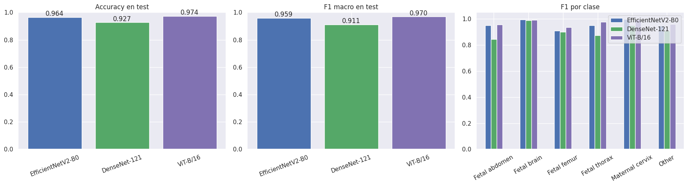

### F1-score por clase

| Clase           | EfficientNetV2-B0 | DenseNet-121 | ViT-B/16 | Imágenes de test |
| --------------- | ----------------- | ------------ | -------- | ---------------- |
| Fetal abdomen   | 0.951             | 0.844        | 0.958    | 140              |
| Fetal brain     | 0.994             | 0.989        | 0.993    | 596              |
| Fetal femur     | 0.911             | 0.901        | 0.935    | 201              |
| Fetal thorax    | 0.952             | 0.875        | 0.977    | 331              |
| Maternal cervix | 0.998             | 0.952        | 0.995    | 285              |
| Other           | 0.947             | 0.908        | 0.959    | 616              |

### Matrices de confusión

| EfficientNetV2-B0             | DenseNet-121              | ViT-B/16             |
| ----------------------------- | ------------------------- | -------------------- |
| 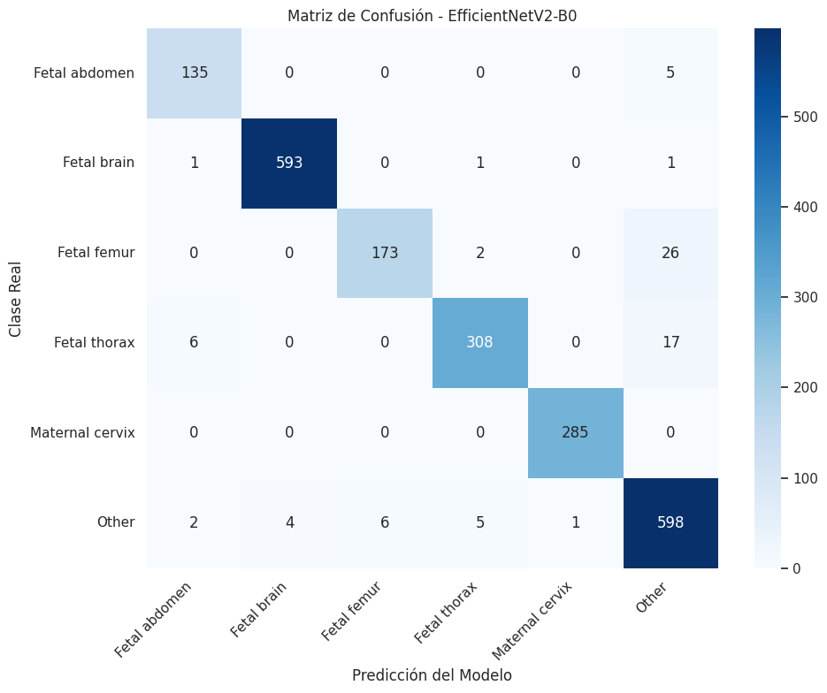 | 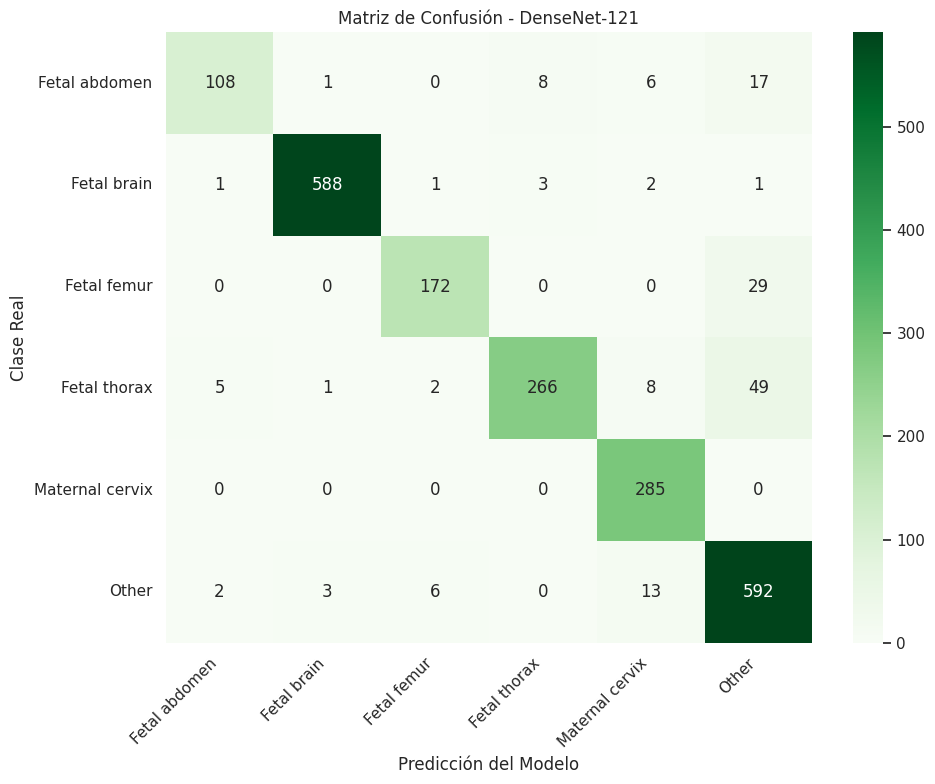 | 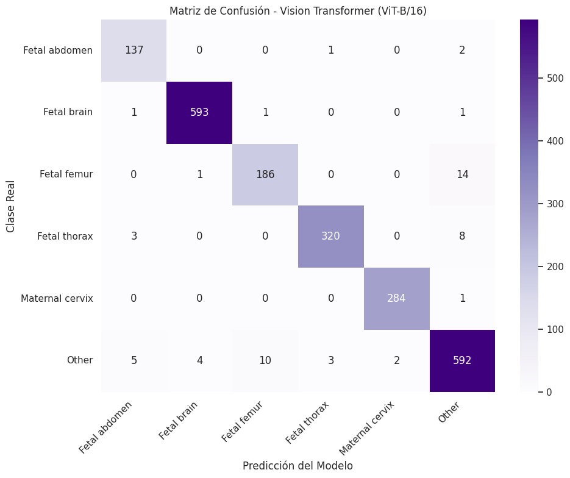 |

En EfficientNetV2-B0 la mayoría de los errores caen en la clase **Other** (26 de 201 fémures y 17 de 331 tórax
se clasificaron como _Other_): son vistas no estándar o ambiguas.

---

## 2. Dataset

**FETAL_PLANES_DB** (Burgos-Artizzu et al., _Scientific Reports_, 2020): ~12,400 imágenes de ecografía
materno-fetal de 1,792 pacientes, adquiridas en dos hospitales con distintos operadores y equipos, y etiquetadas
por un clínico experto en 6 clases: **Fetal abdomen, Fetal brain, Fetal femur, Fetal thorax, Maternal cervix y Other**.

Flujo de depuración (notebook 01):

| Paso                                                                    | Imágenes                 |
| ----------------------------------------------------------------------- | ------------------------ |
| Dataset original                                                        | 12,400                   |
| Duplicados visuales eliminados (pHash)                                  | −1,014 → 11,386          |
| Clase _Other_: 15 % menos nítido eliminado (umbral laplaciano = 647.75) | −543 → **10,843**        |
| División 80/20 estratificada                                            | 8,674 train + 2,169 test |
| Aumento offline de clases minoritarias (solo train, notebook 02)        | +4,238 aumentadas        |

### Análisis exploratorio (EDA)

El dataset está **desbalanceado**: _Other_ es la clase mayoritaria y _Fetal abdomen_ la minoritaria.

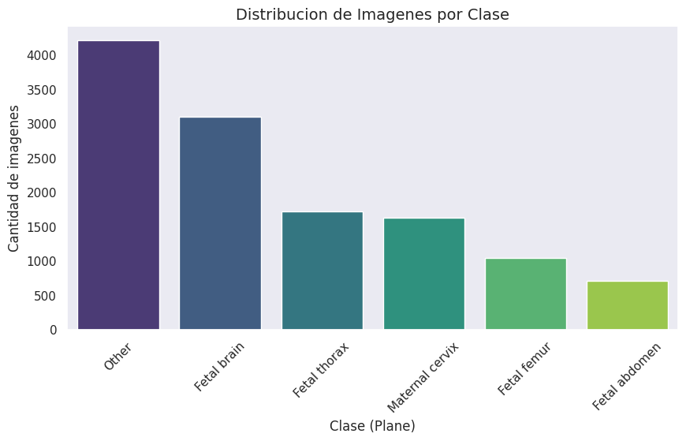

Muestra aleatoria de 16 imágenes del dataset:

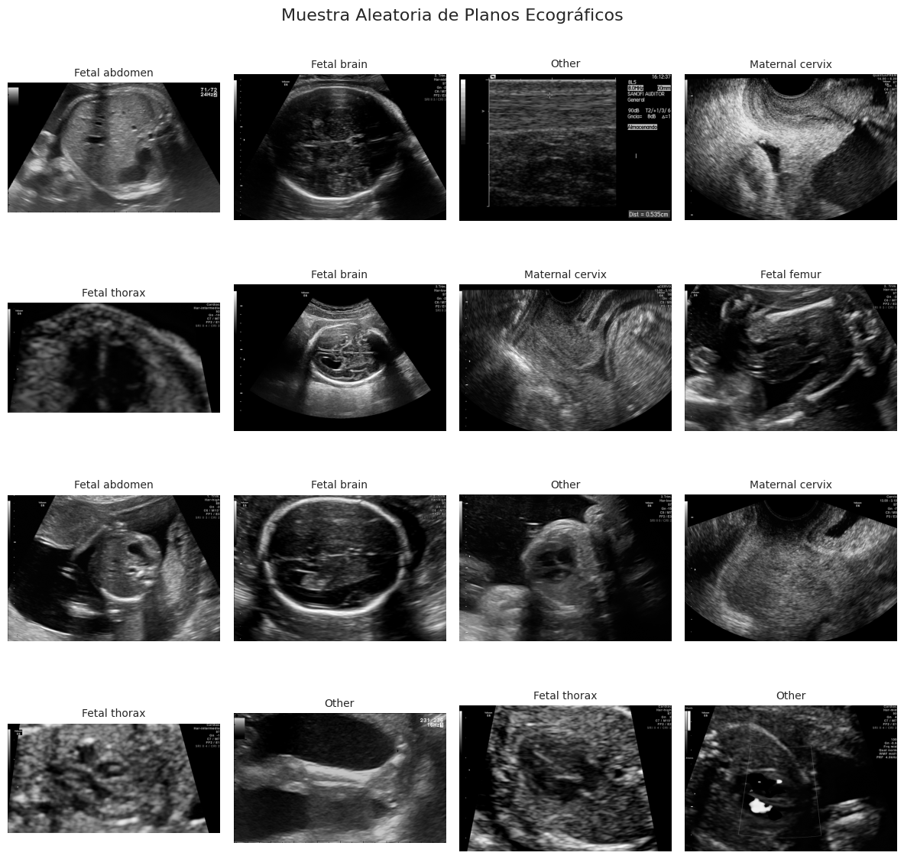

Brillo, contraste y nitidez (varianza laplaciana) por imagen. La nitidez se usó para identificar las imágenes de
menor calidad de la clase mayoritaria:

| Brillo vs. contraste por clase     | Nitidez por clase         |
| ---------------------------------- | ------------------------- |
| 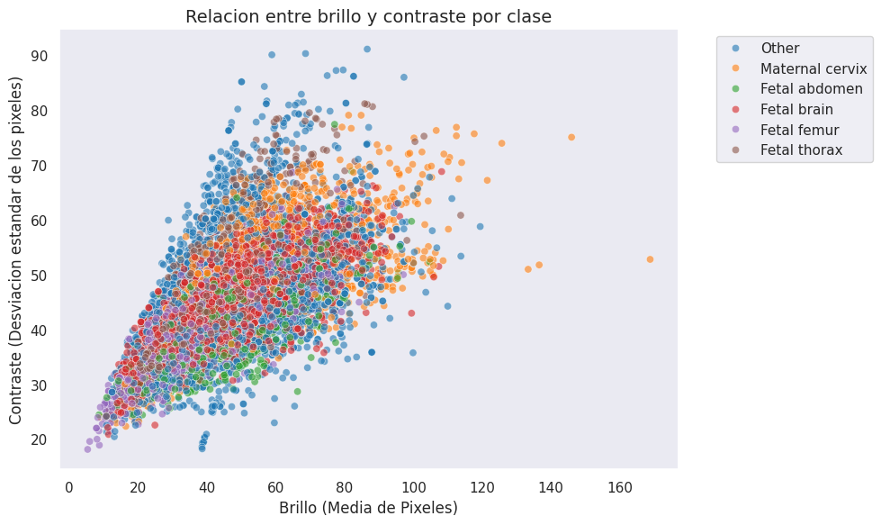 | 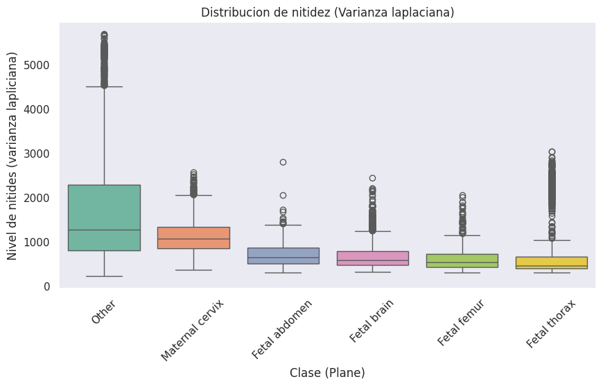 |

Distribución de clases en entrenamiento (originales vs. aumentadas) y en prueba, tras el aumento del notebook 02:

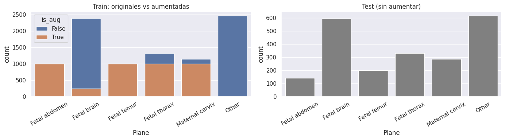

> Las imágenes **no están en este repositorio** por su tamaño (~2 GB). Ver [sección 6](#6-cómo-obtener-el-dataset-y-los-modelos).

---

## 3. Metodología

**Notebook 01: EDA y preprocesamiento** (`notebooks/01_EDA_y_preprocesamiento.ipynb`)

1. Análisis exploratorio: distribución de clases, muestras aleatorias, brillo, contraste y nitidez (varianza laplaciana) por clase.
2. Eliminación de duplicados visuales mediante hash perceptual (pHash): 1,014 duplicados detectados.
3. Descarte del 15 % de imágenes menos nítidas de la clase mayoritaria (_Other_).
4. Las eliminaciones se hacen **antes** de dividir, para que una misma imagen no quede en train y en test.
5. División train/test 80/20 estratificada (`random_state=42`) y exportación de `fetal_planes_train.csv` /
   `fetal_planes_test.csv` (8,674 y 2,169 imágenes). En este notebook las imágenes se redimensionan a 128×128 y se
   normalizan a [0, 1] solo para comprobar el pipeline; el entrenamiento del notebook 02 parte de los archivos
   originales y usa 224×224.

**Notebook 02: Entrenamiento, XAI y benchmark** (`notebooks/02_benchmark_modelos_final.ipynb`)

1. **Aumento offline** (solo en train, nunca en test) de las clases minoritarias: volteo horizontal, rotación ±15° y
   cambios de brillo/contraste, hasta un máximo de 1,000 imágenes nuevas por clase.
2. **Validación separada por paciente** (`StratifiedGroupKFold`), de modo que imágenes del mismo paciente o sus copias
   aumentadas no caigan a la vez en entrenamiento y validación. La validación usa solo imágenes originales.
   Resultado: 10,391 imágenes de entrenamiento, 1,682 de validación y 2,169 de prueba.
3. **Pipeline:** imágenes redimensionadas a 224×224 en 3 canales, `tf.data` con caché en RAM, batch de 64 (32 en el ViT).
4. **Aumento online en GPU** (flip horizontal y vertical, rotación ±30°, zoom 0.2), activo solo durante el entrenamiento.
5. **Entrenamiento en 2 fases** con los mismos datos, aumentos, pesos de clase balanceados y optimizador Adam:

|                                  | Fase 1: cabeza (backbone congelado) | Fase 2: fine-tuning                   |
| -------------------------------- | ----------------------------------- | ------------------------------------- |
| Learning rate                    | 1e-3                                | 1e-5                                  |
| EfficientNetV2-B0 y DenseNet-121 | hasta 3 épocas                      | hasta 10 épocas (BatchNorm congelada) |
| ViT-B/16                         | 3 épocas                            | 6 épocas                              |

Las CNN usan `EarlyStopping`, `ReduceLROnPlateau` y precisión mixta (`mixed_float16`); la cabeza es
GlobalAveragePooling → Dense(64, ReLU) → Dropout(0.1) → Softmax(6). Pesos preentrenados: ImageNet (CNN) y
`google/vit-base-patch16-224-in21k` (ViT). 6. **Explicabilidad:** se usan los **mismos 3 casos de test** (2 aciertos y 1 error) para los tres modelos.

---

## 4. Explicabilidad (XAI)

Las CNN se explican con Grad-CAM, Score-CAM e Integrated Gradients. El ViT no tiene mapas convolucionales, por lo
que se usa **Attention Rollout** (atención acumulada del token `[CLS]` hacia los parches de la imagen).

**EfficientNetV2-B0**
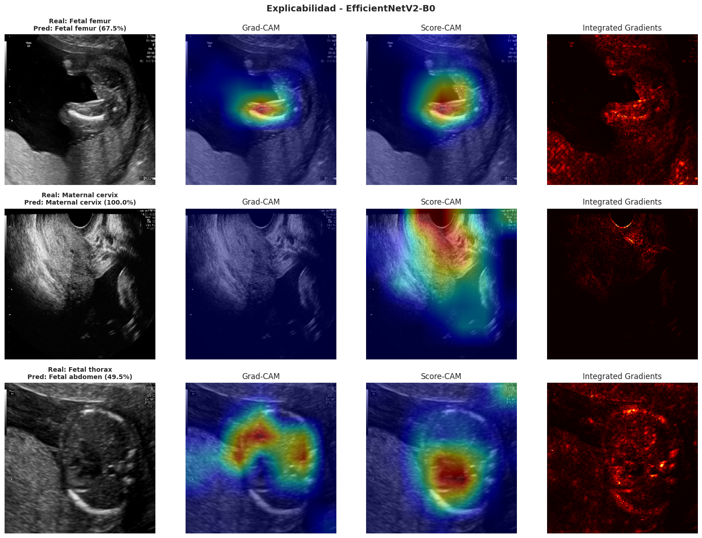

**DenseNet-121**
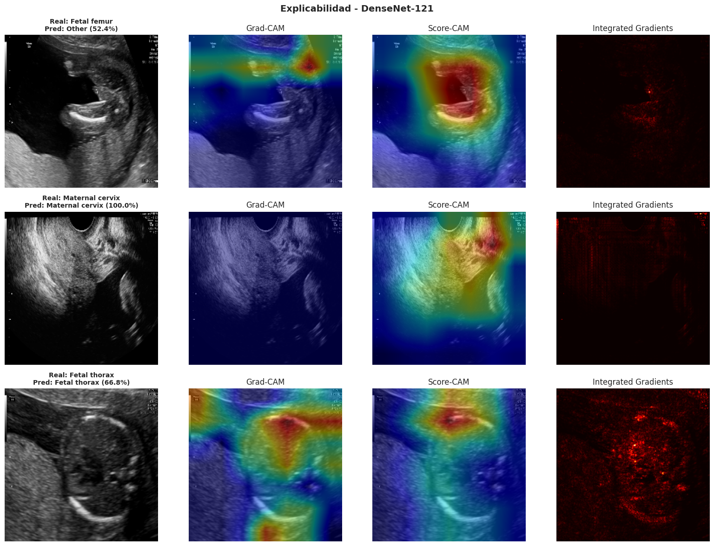

**ViT-B/16 (Attention Rollout)**
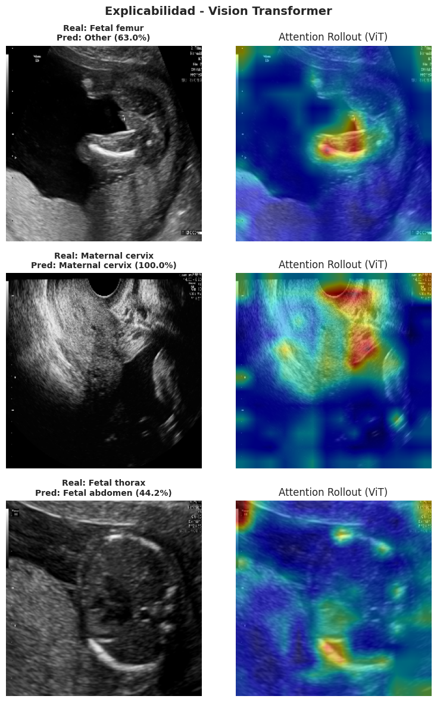

Curva de pérdida del ViT (el notebook guarda las curvas solo de los modelos entrenados con él):

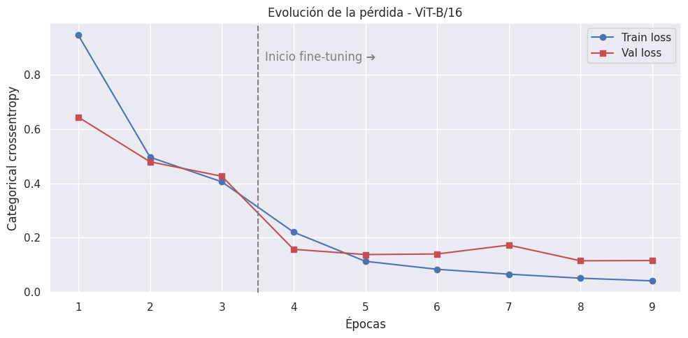

---

## 5. Limitaciones

- **Posible fuga de datos entre train y test.** La división train/test es por imagen y no por paciente: **862 de los
  1,004 pacientes del test también aparecen en entrenamiento**. Por eso las métricas pueden estar infladas respecto
  a lo que se obtendría con pacientes completamente nuevos. (La validación sí se separó por paciente.)
- **Una sola corrida por modelo** (semilla 42): no se midió la variabilidad entre ejecuciones.
- **DenseNet-121 recibe píxeles en rango 0–255 sin `preprocess_input`** (EfficientNetV2 ya lo incluye
  internamente). Esto pudo restarle rendimiento frente a EfficientNetV2-B0; no se modificó para no invalidar el
  modelo ya entrenado.
- **La clase _Other_ concentra la mayoría de los errores** (vistas no estándar o ambiguas).
- **Los mapas XAI son cualitativos:** no demuestran por sí solos que el modelo "razone" como un clínico.
- **Los ViT suelen necesitar más datos o más épocas** que las CNN para ventaja clara en datasets de ~13 mil
  imágenes; aquí el ViT superó a las CNN, pero la diferencia debe leerse con cautela por los puntos anteriores.

---

## 6. Cómo obtener el dataset y los modelos

Las imágenes y los modelos entrenados están en Google Drive (acceso de solo lectura):

| Contenido                                                                                        | Enlace                         |
| ------------------------------------------------------------------------------------------------ | ------------------------------ |
| **Dataset:** carpeta `Images/` (originales + aumentadas `aug_*`) y los CSV                       | <ENLACE_CARPETA_DATASET_DRIVE> |
| **Modelos entrenados:** EfficientNetV2-B0 (`.keras`), DenseNet-121 (`.keras`) y ViT-B/16 (`.pt`) | <ENLACE_CARPETA_MODELOS_DRIVE> |

Para solo **revisar o descargar** los archivos basta con abrir los enlaces (Drive descarga las carpetas grandes en
varias partes `.zip`).

### Opción A: Ejecutar los notebooks en Colab con esas carpetas

1. En cada enlace: clic derecho sobre la carpeta → _Organizar → Añadir acceso directo a Mi unidad_.
2. Deja los accesos directos en la raíz de `Mi unidad` con sus nombres originales: `dataset` y `modelos`.
   Los notebooks buscan `Mi unidad/dataset` y `Mi unidad/modelos` automáticamente.
3. Si los modelos están disponibles, el notebook 02 los **carga** en lugar de reentrenar. Para forzar el
   reentrenamiento pon `RETRAIN_EFNET`, `RETRAIN_DENSENET` o `RETRAIN_VIT = True`.

> **Importante:** el notebook 02 escribe en la carpeta del dataset (figuras, métricas y un CSV). Con permiso de
> **solo lectura** esa escritura falla. En ese caso copia la carpeta `dataset` a tu propio Drive (descargar y volver
> a subir) y úsala desde ahí, o usa la Opción B.

### Opción B: Fuente original (sin depender de este Drive)

Descarga `FETAL_PLANES_ZENODO.zip` (2.1 GB) desde https://zenodo.org/record/3904280 y descomprímelo para que
`Images/` y `FETAL_PLANES_DB_data.csv` queden dentro de una carpeta `dataset` (por ejemplo `/content/dataset`).

1. Ejecuta el notebook 01 para regenerar `fetal_planes_train.csv` y `fetal_planes_test.csv`; **antes de la última
   celda cambia `RUTA_DESTINO`** a esa misma carpeta.
2. Ejecuta el notebook 02: generará las imágenes aumentadas la primera vez si no existen y **entrenará los tres
   modelos** si no encuentra los guardados (el ViT tardó 12.3 min en una GPU de Colab).

Con esta opción los resultados pueden diferir ligeramente de los publicados aquí (los entrenamientos no son
bit a bit reproducibles).

---

## 7. Cómo reproducir

1. Obtén el dataset y los modelos (sección 6, Opción A o B).
2. En Google Colab usa **Entorno de ejecución → GPU (T4)**.
3. `notebooks/01_EDA_y_preprocesamiento.ipynb`: reproduce el EDA y la depuración. Solo es obligatorio si partes de
   los datos originales de Zenodo (Opción B); con la Opción A los CSV de train/test ya vienen en la carpeta `dataset`.
   Ten en cuenta que el cálculo de métricas por imagen puede tardar bastante (unos 12,400 archivos).
4. Ejecuta `notebooks/02_benchmark_modelos_final.ipynb`: las secciones 1 a 4 siempre; luego cada modelo
   (secciones 7, 8 y 9) y el benchmark final (sección 10).

Versiones usadas en Colab: TensorFlow 2.21.0, PyTorch y `transformers` ≥ 5 (a partir de la versión 5
`transformers` ya no admite TensorFlow, por eso el ViT está en PyTorch). Ver `requirements.txt`.

---

## 8. Estructura del repositorio

```
├── README.md
├── requirements.txt
├── .gitignore
├── notebooks/
│   ├── 01_EDA_y_preprocesamiento.ipynb
│   └── 02_benchmark_modelos_final.ipynb
├── presentacion/                 ← diapositivas de la entrega final
├── docs/                         ← figuras de resultados usadas en este README
└── data/                         ← (opcional) CSV de train/test; las imágenes NO se incluyen
```

---

## 9. Autores

- Juan David Gomez
- Jorge Sebastian Fuquene
- Sergio Alejandro Ribero

Curso / Universidad:IA2 UIS

## 10. Licencia y citas

El código de este repositorio se publica bajo licencia MIT (ver `LICENSE`). El dataset FETAL_PLANES_DB tiene
su propia licencia: consúltala en https://zenodo.org/record/3904280.

Si usas este trabajo, cita también el dataset:

> Burgos-Artizzu, X.P., Coronado-Gutiérrez, D., Valenzuela-Alcaraz, B. et al. _Evaluation of deep convolutional neural
> networks for automatic classification of common maternal fetal ultrasound planes._ Sci Rep 10, 10200 (2020).
> https://doi.org/10.1038/s41598-020-67076-5
